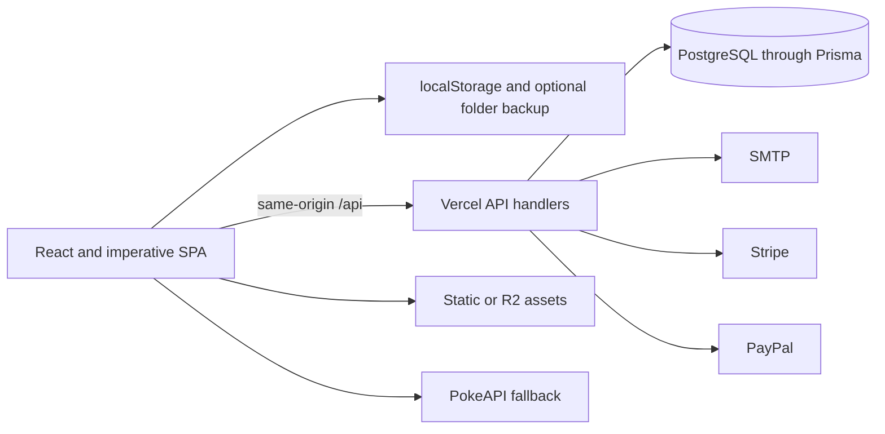

# Architecture

PokemonPGC is a local-first Vite single-page application with optional server-backed identity, cloud progress, save import, and subscriptions. Browser checklist work remains usable when the API is unavailable.

## Runtime topology

`src/main.jsx` mounts React and `src/App.jsx` owns URL routes. Route pages are lazy-loaded. Checklist/account routes mount `AppShell`; `useLegacyBootstrap()` imports `src/index.js` and installs older runtime APIs. Homepage initialization is deferred until idle so marketing visitors do not pay the complete checklist startup cost immediately.

## Client layers

1. **Route/UI:** `src/pages/`, `src/components/`, and `src/App.jsx` own React routes, app/marketing shells, account UI, and newer modal shells.
2. **Bridge:** `src/react-bridge/` converts mutable store and imperative commands into React snapshots and callbacks.
3. **Runtime/domain:** `src/store.js`, `src/tasks*.js`, `src/sync.js`, `src/progress.js`, and `src/modals/` own persistence-sensitive checklist behavior and imperative feature islands.
4. **Content:** `data/` registers games, tasks, Dexes, distributions, layouts, and collectibles. `data/bootstraps/` splits this material by generation.

React and imperative code must not independently own the same subtree or global listener. `ImperativeContentMount.jsx`, `ModalShell.jsx`, and the bridge adapters are the intended ownership boundaries.

## State and globals

`src/store.js` owns mutable `store.state` and persists it under `ppgc_v1`. `usePpgcSnapshot()` listens for bridge events so React reflects imperative mutations.

Compatibility-sensitive browser interfaces include:

- `window.PPGC`: registration/command namespace and legacy runtime hooks
- `window.DATA`: registered content buckets
- `window.store`: mutable state exposed for legacy consumers
- `globalThis.__ASSET_BASE_URL__` and `globalThis.__API_BASE_URL__`: build/runtime URL configuration

New code should use narrow bridge/service modules instead of expanding these globals. Search every consumer before renaming a member, DOM ID, storage key, task ID, game key, or serialized property.

## Server boundary

Files below `api/` run server-side. Handlers authenticate with the HMAC-signed `ppgc_session` cookie, validate input, scope database work to the session user, and return JSON with private responses marked `no-store`.

`api/_lib/` owns authentication/session parsing, one-time tokens, SMTP, Prisma access, validation, rate limiting, provider verification, entitlement mapping, and save-parser dispatch. Never import these modules into the browser bundle because they read secrets and database configuration.

## Loading strategy

- Route pages use React lazy boundaries.
- Generation data loads through dynamic `data/bootstraps/gen*.js` imports.
- Heavy model-viewer and modal implementations load only when needed.
- Pokemon Info renders a bounded initial set and lazy-loads sprites.
- `npm run build` enforces homepage JavaScript, CSS, and media budgets.

## Known tradeoffs

- Hybrid ownership reduces rewrite risk but requires stable bridge contracts.
- Whole-snapshot persistence favors recovery simplicity over conflict-aware merging.
- Serverless in-memory rate limiting is a best-effort throttle, not a distributed guarantee.
- Billing state is summarized on `User`; there is no durable provider-event ledger.
