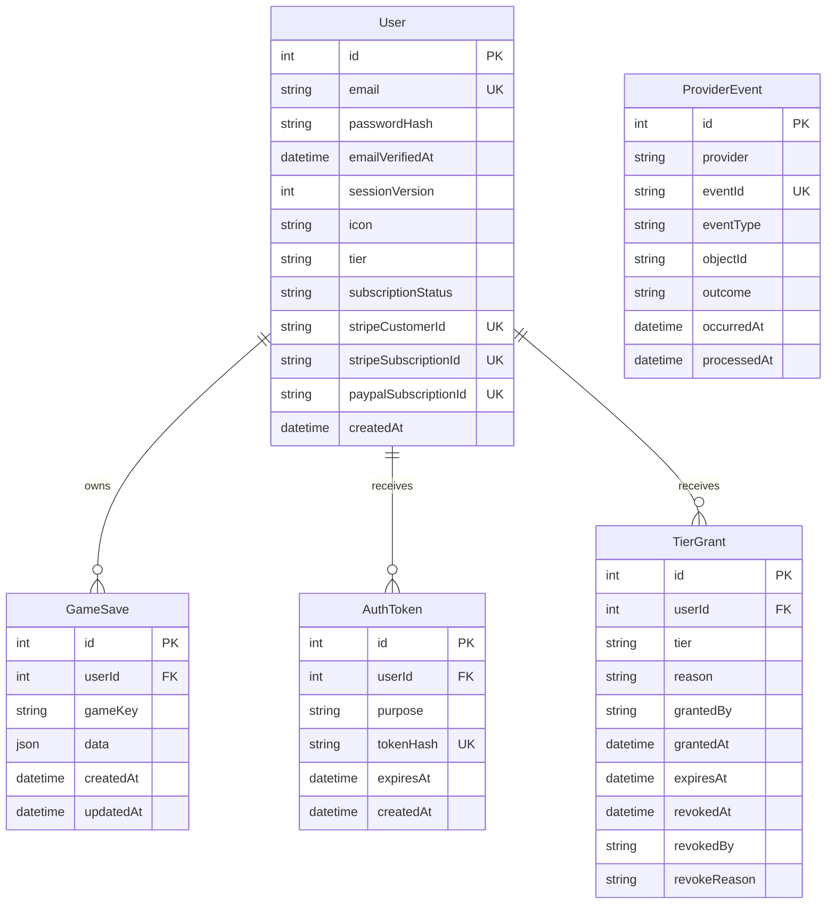

# Data Model

`prisma/schema.prisma` is the checked-in PostgreSQL target. The auth and
provider-event migrations were verified against the configured database on
2026-11-01. The additive `TierGrant` migration is staged but not yet applied.

## Rules

- `User.email` is unique; application validation trims and lowercases it.
- Passwords are bcrypt hashes. Plaintext passwords never belong in the database.
- `emailVerifiedAt = null` prevents login for newly created accounts.
- Incrementing `sessionVersion` invalidates all older signed cookies.
- One `GameSave` exists per `(userId, gameKey)` and is deleted with its user.
- `GameSave.data` is a whole JSON snapshot. The API enforces a plain object with at most 1,000,000 serialized characters.
- `AuthToken` stores a SHA-256 digest, never the raw verification/reset token; user deletion cascades tokens.
- Provider IDs are unique nullable bindings. Effective paid access also requires an entitled provider status.
- `ProviderEvent` keeps bounded provider IDs and outcomes for deduplication/support without storing raw webhook payloads or customer details. Its compound `(provider, eventId)` key is unique.
- `TierGrant` is append-only grant history except for revocation fields. Active,
  unexpired grants combine with provider access by taking the higher tier; they
  never impersonate a paid subscription.

## Current limitations

- Tier/status strings are not database enums or constrained values.
- Game saves have no schema version, revision, compare-and-swap field, or merge history.
- Full subscription history is not modeled; Stripe remains authoritative beyond the bounded provider-event receipts.
- `User` has no `updatedAt` audit field.
- Profile icons may be large inline image data URLs.

See [database current state](database/current-state.md) for the current assessment and [database proposal](database/proposal.md) for review-only rollout and future safe-additive work.
